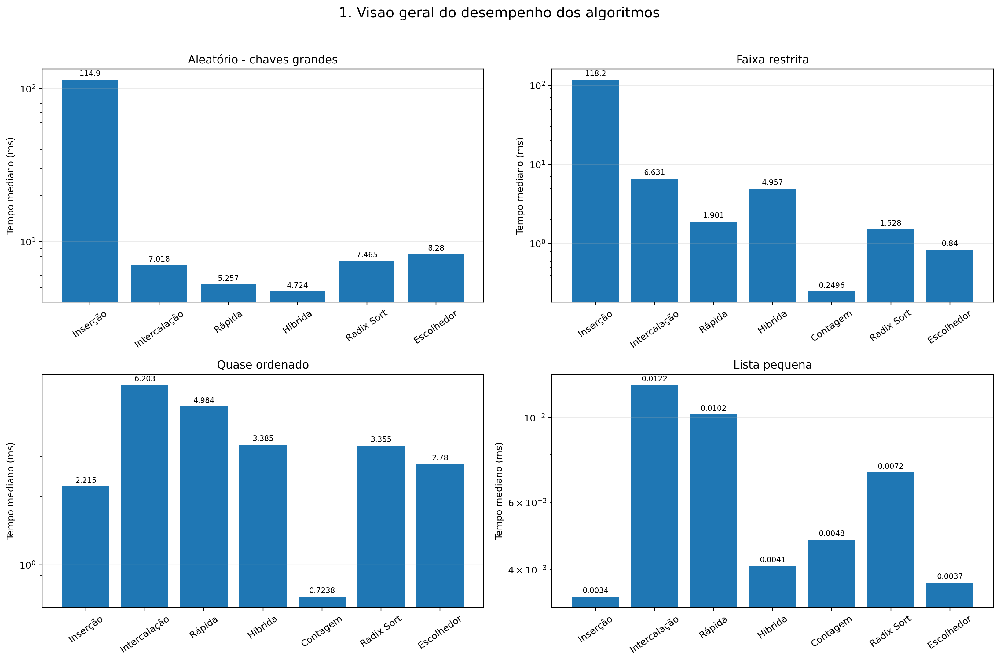
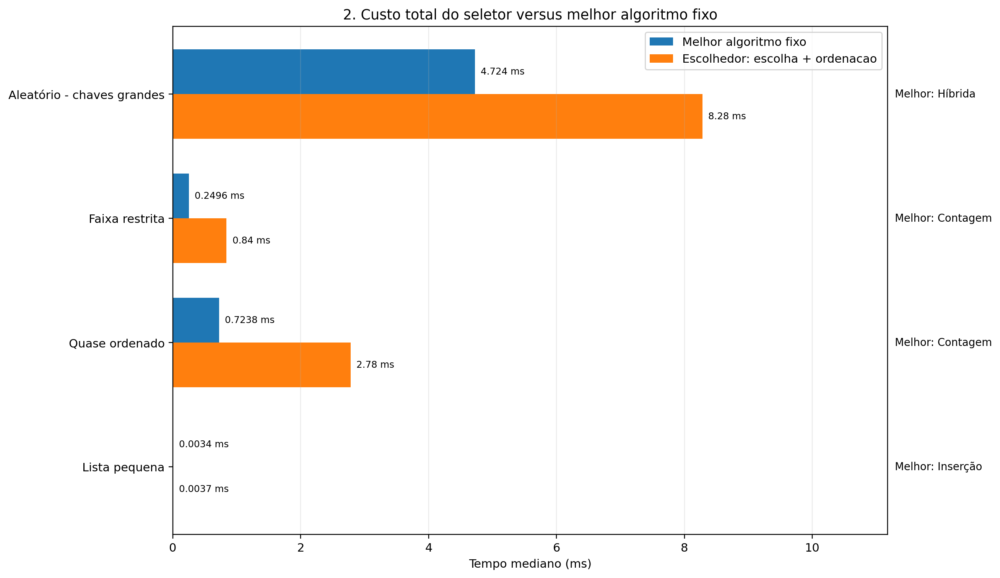
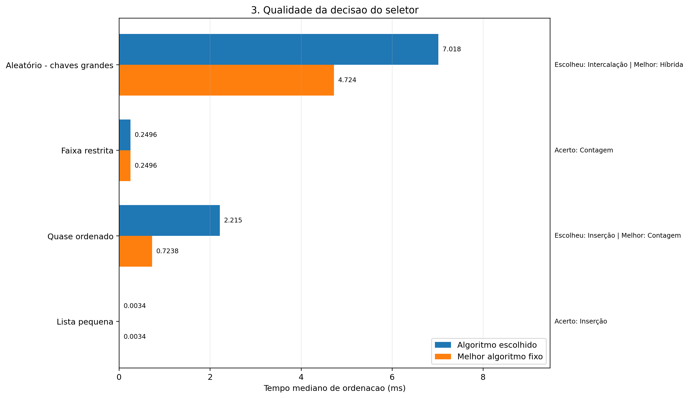
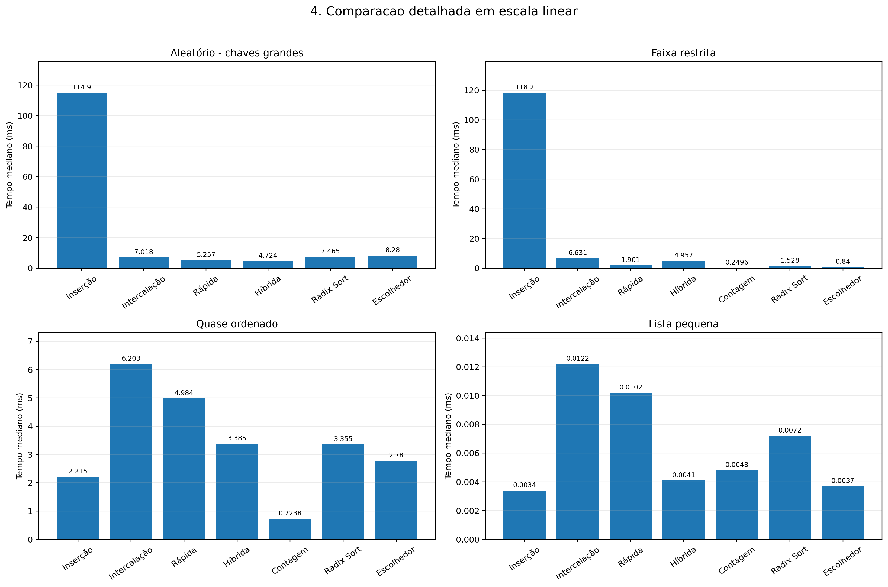

# Relatório — Projeto G2: Escolhedor de Ordenação

## 1. Objetivo

O objetivo do projeto é reunir seis métodos de ordenação estudados no semestre e desenvolver um seletor que escolha um deles de acordo com características da lista de entrada. Também foram realizados testes automatizados e medições de desempenho em quatro cenários.

As funções principais são:

- `escolher(v)`: analisa a lista e devolve a função de ordenação escolhida.
- `ordenar(v)`: executa a função retornada por `escolher(v)`.

## 2. Métodos avaliados

1. Inserção.
2. Intercalação (Merge Sort).
3. Rápida com pivô aleatório (Quick Sort).
4. Híbrida, combinando intercalação e inserção.
5. Contagem (Counting Sort).
6. Base (Radix Sort).

O Escolhedor também é medido, mas não é um sétimo algoritmo fixo: ele é uma estratégia que analisa a entrada e chama um dos seis métodos.

## 3. Metodologia experimental

Foram utilizados quatro cenários:

| Cenário | Entrada utilizada | Característica avaliada |
|---|---|---|
| Aleatório com chaves grandes | 2.000 inteiros aleatórios entre -1.000.000.000 e 1.000.000.000 | Faixa numérica muito ampla |
| Faixa restrita | 2.000 inteiros entre 0 e 50 | Muitos valores repetidos e faixa pequena |
| Quase ordenado | Lista de 0 a 1.999 com 20 trocas aleatórias | Lista quase ordenada |
| Lista pequena | `[8, 3, 5, 1, 9, 2, 7, 4]` | Poucos elementos |

Cada método foi medido em sete repetições. A tabela utiliza a mediana dos tempos em milissegundos. Os resultados podem variar com o computador, a versão do Python e a carga do sistema.

O Counting Sort foi registrado como inadequado no cenário de chaves grandes, pois sua faixa de valores excede o limite de segurança da implementação. Não foi atribuído tempo a essa execução.

## 4. Resultados: os quatro cenários contra os seis métodos fixos

Tempos medianos em milissegundos. O menor tempo válido de cada cenário aparece em **negrito**.

| Cenário | Inserção | Intercalação | Rápida | Híbrida | Contagem | Radix Sort |
|---|---:|---:|---:|---:|---:|---:|
| Aleatório com chaves grandes | 114,9113 | 7,0176 | 5,2568 | **4,7237** | Inadequado | 7,4645 |
| Faixa restrita | 118,1753 | 6,6314 | 1,9007 | 4,9567 | **0,2496** | 1,5284 |
| Quase ordenado | 2,2145 | 6,2027 | 4,9839 | 3,3852 | **0,7238** | 3,3546 |
| Lista pequena | **0,0034** | 0,0122 | 0,0102 | 0,0041 | 0,0048 | 0,0072 |

### 4.1 Qual venceu cada cenário, e por quê?

**Aleatório com chaves grandes — Híbrida (4,7237 ms).**  
A Inserção teve desempenho muito pior porque precisa deslocar muitos elementos em uma lista grande e desordenada. A Híbrida foi a mais rápida nesta medição, enquanto o Counting Sort foi considerado inadequado por causa da faixa de valores.

**Faixa restrita — Contagem (0,2496 ms).**  
A faixa de valores é pequena em relação à quantidade de elementos. O Counting Sort consegue contar as ocorrências e reconstruir a lista sem precisar comparar repetidamente os elementos, por isso teve o menor tempo medido.

**Quase ordenado — Contagem (0,7238 ms).**  
Apesar de a lista estar quase ordenada, o Counting Sort foi o mais rápido nos dados medidos. A Inserção também teve um tempo relativamente baixo (2,2145 ms), coerente com seu bom comportamento em entradas quase ordenadas, mas não venceu este teste.

**Lista pequena — Inserção (0,0034 ms).**  
Para oito elementos, o custo de organização e execução dos métodos mais complexos pode superar qualquer vantagem assintótica. A Inserção teve o menor tempo medido.

Essas conclusões descrevem os dados e o ambiente desta execução; não significam que o mesmo método vencerá em toda entrada com a mesma descrição.

## 5. Resultado do Escolhedor

| Cenário | Método escolhido | Tempo total do Escolhedor (ms) | Custo de escolha (ms) | Melhor método fixo | Tempo do melhor fixo (ms) |
|---|---|---:|---:|---|---:|
| Aleatório com chaves grandes | Intercalação | 8,2803 | 0,4958 | Híbrida | 4,7237 |
| Faixa restrita | Contagem | 0,8400 | 0,6274 | Contagem | 0,2496 |
| Quase ordenado | Inserção | 2,7802 | 0,5091 | Contagem | 0,7238 |
| Lista pequena | Inserção | 0,0037 | 0,0003 | Inserção | 0,0034 |

O tempo total do Escolhedor inclui o custo de análise e a execução do método escolhido. O custo de escolha foi medido separadamente, portanto não deve ser somado novamente ao tempo total apresentado.

## 6. Regras usadas por `escolher(v)`

As regras atuais são aplicadas nesta ordem:

1. **Lista com até 16 elementos:** escolhe Inserção. A regra evita aplicar métodos mais complexos a entradas pequenas.
2. **Lista quase ordenada:** conta quantas vezes um elemento é menor que o anterior. Se a quantidade de inversões adjacentes for menor ou igual a `n // 20`, escolhe Inserção.
3. **Lista com menos de 100 elementos:** escolhe o método Híbrido, caso as regras anteriores não tenham sido acionadas.
4. **Faixa de valores menor que a quantidade de elementos:** escolhe Contagem, pois a faixa é pequena em relação ao tamanho da lista.
5. **Valores todos não negativos:** escolhe Radix Sort.
6. **Demais casos:** escolhe Intercalação, incluindo entradas com números negativos e faixa ampla.

A ordem das regras importa. Por exemplo, a regra de lista quase ordenada é avaliada antes da regra de faixa restrita; por isso, uma lista que satisfaz ambas pode ser direcionada para Inserção.

### De onde vieram as regras?

As regras foram definidas com base nas características dos algoritmos e nas medições experimentais:

- Inserção é simples e costuma funcionar bem em listas pequenas e quase ordenadas.
- Contagem pode ser muito eficiente quando a faixa de inteiros é pequena.
- Radix Sort é uma opção para inteiros não negativos na implementação usada.
- Intercalação é uma alternativa geral para casos que não atendem às condições anteriores.
- O limite de 16 elementos e o limite de 100 elementos são parâmetros heurísticos do projeto, não constantes universais. Poderiam ser ajustados após novos experimentos.

## 7. Quanto custa executar o seletor? Ele compensa?

O custo isolado da escolha ficou entre **0,0003 ms e 0,6274 ms** nos cenários medidos. A análise percorre os dados para obter extremos, verificar valores negativos e contar inversões adjacentes. Isso adiciona trabalho antes da ordenação.

Comparando o tempo total:

- **Chaves grandes:** Escolhedor = 8,2803 ms; melhor fixo = 4,7237 ms. O seletor perdeu por 3,5566 ms.
- **Faixa restrita:** Escolhedor = 0,8400 ms; melhor fixo = 0,2496 ms. O seletor perdeu por 0,5904 ms, embora tenha escolhido Contagem, que foi o melhor método fixo.
- **Quase ordenado:** Escolhedor = 2,7802 ms; melhor fixo = 0,7238 ms. O seletor perdeu por 2,0564 ms.
- **Lista pequena:** Escolhedor = 0,0037 ms; melhor fixo = 0,0034 ms. A diferença foi de 0,0003 ms.

**Conclusão:** neste conjunto de medições, o seletor não superou o melhor algoritmo fixo em nenhum cenário. Ele escolheu o vencedor em dois cenários (faixa restrita e lista pequena), mas o custo de análise fez com que o tempo total ainda fosse maior. A heurística é funcional, mas ainda pode ser melhorada.

## 8. Um cenário em que o seletor erra

O exemplo mais claro é o cenário **quase ordenado**:

- O seletor escolheu Inserção.
- Inserção levou 2,2145 ms.
- Contagem levou 0,7238 ms.
- O tempo total do Escolhedor foi 2,7802 ms.

A escolha de Inserção é coerente com a regra de lista quase ordenada, mas não foi a mais rápida nesta entrada. Isso demonstra a limitação de uma heurística: uma característica isolada, como a quantidade de inversões adjacentes, não garante que o algoritmo escolhido será o mais rápido.

Também houve uma escolha não ideal no cenário de chaves grandes: o seletor escolheu Intercalação, enquanto a Híbrida foi mais rápida.

## 9. Proteção contra faixa muito grande no Counting Sort

O Counting Sort utiliza uma estrutura proporcional à faixa de valores. Se a lista contiver valores muito distantes entre si, a estrutura de contagem poderá consumir memória excessiva. A implementação impõe um limite e lança `ValueError` quando a faixa é grande demais.

O benchmark captura essa condição e registra o método como **Inadequado**, em vez de interromper todos os testes. O seletor também precisa evitar encaminhar entradas de faixa ampla para a Contagem.

## 10. Testes automatizados

Os testes contemplam:

- Lista vazia.
- Lista com um elemento.
- Elementos iguais.
- Lista já ordenada.
- Lista invertida.
- Valores negativos.
- Preservação da lista original.
- Escolha de métodos em diferentes cenários.
- Rejeição de faixa excessiva pelo Counting Sort.

Na execução registrada durante o desenvolvimento, **18 testes passaram**. Para reproduzir o resultado no ambiente atual, execute:

```powershell
python -m pytest tests/ -v
```

## 11. Gráficos

Os gráficos são gerados a partir do CSV do benchmark e ficam em `resultados/graficos/`.

### Visão geral do desempenho



### Custo total do seletor



### Qualidade da decisão



### Comparação em escala linear



## 12. Como reproduzir as medições

Instale as dependências:

```powershell
python -m pip install pytest matplotlib
```

Execute os testes:

```powershell
python -m pytest tests/ -v
```

Execute o benchmark oficial:

```powershell
python benchmarks/executar_benchmarks.py
```

Gere os gráficos depois que o CSV for atualizado:

```powershell
python benchmarks/gerar_graficos.py
```

O benchmark sobrescreve `resultados/resultados.csv`. Para que os gráficos apareçam no GitHub, mantenha os PNGs em `resultados/graficos/` e envie esses arquivos junto com o README e o relatório.

## 13. Conclusão

O projeto reuniu seis algoritmos de ordenação e implementou uma estratégia de seleção baseada em características da entrada. As medições mostram que não existe um método vencedor em todos os cenários: Contagem se destacou na faixa restrita e no cenário quase ordenado; Híbrida venceu nas chaves grandes; Inserção venceu na lista pequena.

O seletor tomou decisões coerentes com as regras implementadas, mas não foi mais rápido que o melhor método fixo em nenhum dos quatro cenários medidos. Isso evidencia o ponto central do trabalho: analisar a entrada tem um custo e uma heurística simples pode escolher um método adequado sem necessariamente escolher o mais rápido.

Como melhoria futura, seria possível recalibrar os limites do seletor com mais tamanhos de entrada, diferentes distribuições e novas repetições, mantendo a análise barata e protegendo a memória no uso do Counting Sort.
